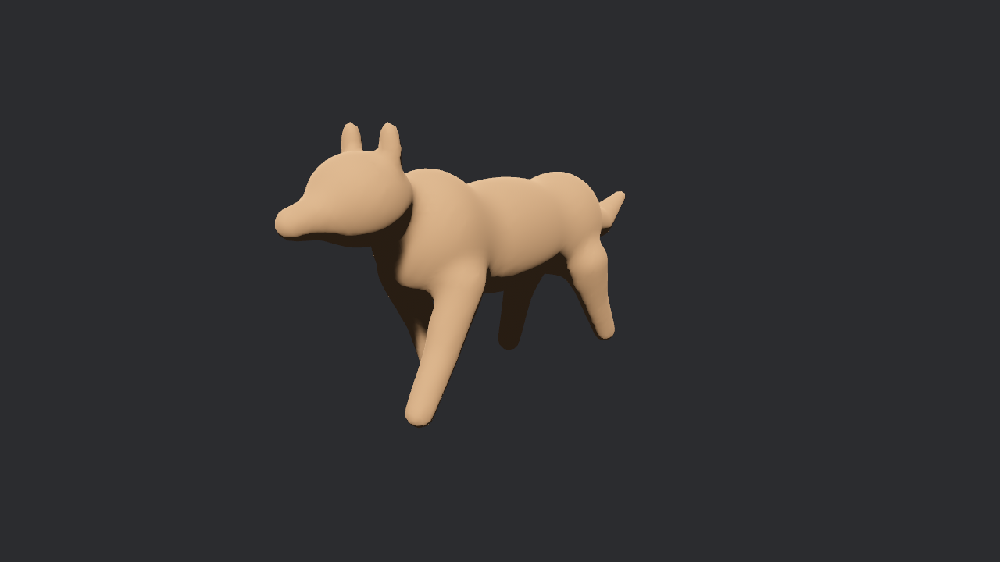
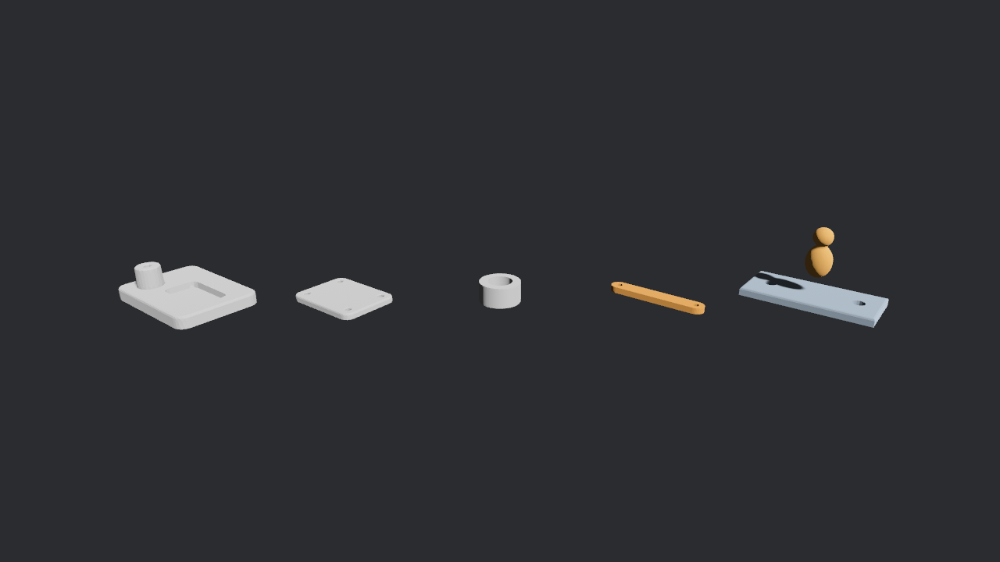

# gcad-bevy

`bevy/` is the crate `gcad-bevy`: a Bevy asset loader that turns `.gcad` and `.gasm` files into
scenes while the game runs. It builds models with gcad's `gcad2glb` library (gcad #310), so a
game ships the gcad text instead of GLBs and never runs the gcad CLI. It grew out of
kids-free-games `crates/app/src/gcad.rs`.

## Install

```toml
gcad-bevy = { git = "https://github.com/v0l/gcad-engines", rev = "<rev>" }
```

The repo is public, so cargo fetches it with no credentials.

Features:

| feature | what it adds |
|---|---|
| `multi_threaded` (default) | Bevy's multi-threaded task pools. Leave it off (`default-features = false`) when the game runs Bevy single-threaded: models then build on the main thread's local executor |
| (none) | mesh files: blockout, sculpt, rigs, skins, clips, correctives, LODs; flat solids (`rect`, `extrude`, ...) through gcad-mesh. Builds for wasm32 and Android |
| `brep` | files with kernel solids (`hole`, `fillet`, `plane plate.end`, ...) and `.gasm` assemblies. Pulls in monstertruck: copy the `[patch.crates-io]` table from `bevy/Cargo.toml` into the game's root `Cargo.toml` |
| `parallel` | rayon inside gcad-mesh |
| `hot-reload` | Bevy's file watcher: saving a `.gcad`, or a file it `include`s, rebuilds the model |
| `window` | only for the examples |

Supported Bevy: 0.20 (tested with 0.20.1, the version kids-free-games locks).

## Use it

```rust
use bevy::prelude::*;
use bevy::world_serialization::WorldAssetRoot;
use gcad_bevy::prelude::*;

fn main() {
    App::new()
        .add_plugins((DefaultPlugins, GcadPlugin::default()))
        .add_systems(Startup, setup)
        .run();
}

fn setup(mut commands: Commands, assets: Res<AssetServer>, mut graphs: ResMut<Assets<AnimationGraph>>) {
    let settings = GcadSettings::fit_height(1.0);
    let hero = assets.load_gcad("models/hero.gcad", settings.clone());
    let walk = assets.load_gcad_clip("models/hero.gcad", "walk", settings);
    let (graph, node) = AnimationGraph::from_clip(walk);
    commands.insert_resource(Walk(graphs.add(graph), node));
    commands.spawn(WorldAssetRoot(hero));
}

#[derive(Resource)]
struct Walk(Handle<AnimationGraph>, AnimationNodeIndex);
```

The scene root carries the `AnimationPlayer`; give it an `AnimationGraphHandle` and call
`play(node)` (see `bevy/examples/hero.rs`). `assets.load("x.gcad")` works too and uses the
default settings.

Load clips and labelled assets with the same settings as the scene (`load_gcad_clip`, or
`load_builder().with_settings(...)`). Bevy keys an asset on its path and settings: a plain
`assets.load("hero.gcad#Animation/walk")` loads the file again with default settings and replaces
the fitted scene with an unfitted one.

Run the examples against a gcad checkout (`GCAD_REPO`, default `../../gcad`):

```sh
cd bevy
cargo run --release --example hero --features window
cargo run --release --example props --features window,brep
```

`hero` (walk clip playing) and `props` (solid parts and a skinned mascot), captured in a private
headless sway with `scripts/headless-shot.sh`:




## What a file becomes

- One child entity per body (named after it), and under it one entity per part with `Mesh3d`,
  a `StandardMaterial` (part colour as base colour, `roughness = 1 - 0.8 * gloss`, or white with
  vertex colours when the body is painted) and a `GcadPart { body, part, lod }`.
- Rigged bodies: a joint entity per bone with `AnimationTargetId` and `AnimatedBy`, a
  `SkinnedMesh` on every part (joint indices and weights, inverse bind matrices from the bone
  heads), `NoFrustumCulling`, and one `AnimationClip` per `clip` as `file.gcad#Animation/<name>`.
- Correctives become morph targets: a `<body>/Morphs` entity holds `MorphWeights` at their rest
  values, the parts reference it with `MeshMorphWeights`, and each clip drives the weights.
- `lod` levels spawn as more parts with `GcadPart.lod = 1, 2, ...`. Set
  `lod_distances: vec![10.0, 30.0]` to give each level a `VisibilityRange`; without it every
  level is visible and the game picks.
- The root has `GcadModel { clips, bounds_min, bounds_max, triangles }`.
- Labelled assets: `<body>/<part>/Mesh`, `<body>/<part>/Material`, `<body>/LOD<k>/<part>/...`,
  `<body>/Skin`, `Animation/<clip>`.

## Settings (`GcadSettings`)

| field | meaning |
|---|---|
| `detail` | remesh cell scale, above 1 is coarser (mesh-only files) |
| `vars` (`set(name, value)`) | override `let` values |
| `height`, `scale` | fit: scale to this height with the lowest point at 0, or by this factor |
| `centre` | `No`, `Yes`, or `Unrigged` (centre props, leave rigged models on their origin, as kids-free-games does) |
| `triangles`, `max_error` | decimate every body |
| `lods` | replace the file's `lod` levels (`Some(vec![])` drops them) |
| `lod_distances` | camera distances between LOD levels, for `VisibilityRange` |
| `cache` | use the build cache (default true) |

`GcadSettings::fit_height(1.0)` is what kids-free-games used: one unit high, feet at 0, props
centred.

## Includes, caching and threads

`include file.gcad` lines, and the files a model names (`part x.gcad`, stamps, fonts), are read
through Bevy's asset reader, so they work from an Android APK and over HTTP on the web, and they
are loader dependencies, so hot reload follows them.

The cache key is gcad's `Sources::key` (gcad version, text with includes expanded, every option,
the path and bytes of each file the text names; [caching.md](caching.md)) folded with the
`centre` setting and the bitcode format tag. A model is looked up in three places, and only
built when all three miss:

1. memory: the last 16 models built this run.
2. the shipped bake: `<assets>/gcad-baked/<key>.bin`, read through the asset reader (APK, HTTP,
   app bundle). `index.json` is read once per run; a key that is not in it is not fetched, and an
   index from another gcad version or format is ignored.
3. the disk cache: `<cache dir>/<key>.bin` with a `<key>.json` sidecar.

The disk cache is on by default on desktop (`$XDG_CACHE_HOME/gcad/bevy`, `~/.cache`,
`%LOCALAPPDATA%`), Android (`<app data>/cache/gcad/bevy`, from `ANDROID_APP`) and iOS
(`$HOME/Library/Caches/gcad/bevy` in the sandbox). Web has none: the shipped bake covers it, and
IndexedDB or Cache Storage would save only the 1-3 ms each `.bin` takes over HTTP.
`GcadPlugin::without_disk_cache()` or `GCAD_NO_PART_CACHE` turns it off,
`GcadPlugin::with_cache_dir(dir)` moves it, `baked_dir: None` skips the bake.

A bad file (wrong format tag, truncated, not bitcode) is a miss; on disk it is deleted and
rebuilt. Writes go to a temp file and are renamed, so two processes writing one key leave one
whole file. A read touches the file's mtime. On start, with a disk cache, a task on the
`IoTaskPool` removes entries untouched for `max_cache_age` (30 days) and the oldest beyond
`max_cache_bytes` (64 MB), never one used this run or named in the shipped index.

`GcadStats` counts `builds()`, `hits_baked()`, `hits_disk()`, `hits_memory()` and reports
`bytes_on_disk()`. Builds run on Bevy's `AsyncComputeTaskPool`, off the main thread.

### Bake at build time

```sh
cargo run --release --bin gcad-bevy-bake -- --height 1 --centre unrigged assets   # writes assets/gcad-baked/
cargo run --release --bin gcad-bevy-bake -- --check --height 1 --centre unrigged assets
```

`gcad_bevy::bake::bake(assets, settings_for)` and `bake::check` do the same from a build script
or test, with a settings function per asset path (`None` skips a file). Give it the same function
the game loads with, or the keys miss. `--check` exits 1 when a model has no entry, a stale one,
or a file that does not decode, so CI can refuse a release with unbaked models. Files only
reached through `include` are not baked on their own. A bake reuses entries that are already
there and deletes the ones no source names any more.

kids-free-games (`settings(scale)`, 14 models from 140549 B of text, measured with
`KIDS_GAMES_ASSETS=... cargo test --release --features parallel --test cache every_model -- --nocapture`):

| model | bitcode B | gzip -9 B | build ms | from bake ms |
|---|---|---|---|---|
| hero | 520099 | 250218 | 529 | 6 |
| prop_tree | 72400 | 43418 | 100 | 5 |
| 12 other props | 742417 | 93397 | 4-6 each | 3-5 each |
| all 14 | 1334916 | 387033 | | |

The bake takes 0.6 s on desktop, and 0 s when nothing changed. Starts of kids-free-games, time
until every model is ready (release builds, `ModelsPlugin`):

| | no bake, empty cache | no bake, warm disk cache | shipped bake, first start |
|---|---|---|---|
| Desktop, private headless sway | 672-730 ms, 14 builds | 103-113 ms | 108-112 ms, 0 builds |
| Android emulator `kidsgames-test` x86_64 | 1337 ms, 14 builds | 558-675 ms | 496-798 ms, 0 builds |
| iOS simulator, iPad Pro 11-inch (M4) | 942 ms, 14 builds | 110-112 ms | 106-115 ms, 0 builds |
| Web, headless Chrome | 2765-3044 ms, 14 builds | (no disk cache) | 2081-2677 ms, 0 builds |

With the bake the first start after an install builds nothing on every platform. On the
emulator and the web what is left is the rest of the app start: on the web the models wait for
the 13 MB of sound files that load before them.

## One file talks to gcad

`bevy/src/source.rs` is the only file that calls gcad: it runs `gcad2glb::Assets` and converts
the result into the crate's own `Built` model (`bevy/src/built.rs`), which the scene builder and
the cache use. A gcad API change, or a switch to another gcad entry point, is a change to that
one file.

## Limits

- `.gasset` (the game-asset pipeline) is not loaded: that pipeline lives in gcad-view behind the
  `game-assets` feature, with egui and wgpu, which a game should not link. Export the `.gasset`
  to GLB with `gcad export` and load it with `bevy_gltf`.
- `.gasm` and kernel solids that read other files (`part`, stamps) need `brep` and assets on disk
  (desktop): gcad-brep reads those files itself, not through Bevy's asset reader.
- `.gsim` files are refused.

## Tests

```sh
cd bevy
GCAD_REPO=../target/gcad cargo test --release                    # mesh only
GCAD_REPO=../target/gcad cargo test --release --features brep    # solid parts and assemblies
GCAD_REPO=../target/gcad cargo test --release --features hot-reload
cargo check --release --lib --target wasm32-unknown-unknown
cargo ndk -t arm64-v8a check --release --lib --features bevy/android-game-activity
```

`tests/load.rs` runs Bevy with `MinimalPlugins` (no window, no GPU) and loads every
`examples/mesh/*.gcad` from gcad, checking mesh, triangle, joint and clip counts against the
library, the fitted height, the morph weight curve, LOD ranges, nested includes, error lines,
the disk cache across two apps, and with `brep` a solid part and `assemblies/linkage.gasm`.

`tests/cache.rs` covers the cache layers: a baked model loads with no build and equals the built
one, and its key is the key the loader computes; an edit to the model or a nested include
misses the bake, builds once, then hits the disk cache, and `--check` reports it stale; a stamp
file, the fit height, `centre` and the gcad version are in the key; an index from another gcad
version is ignored; a wrong format tag, truncated or empty file (baked or cached) is rebuilt and
replaced; cleanup removes a 31-day-old orphan and the oldest past the size cap and keeps the
entries used this run and the shipped ones; the startup cleanup runs on its own; four apps
writing one key leave one valid file; a second model with the same source is a memory hit; the
`gcad-bevy-bake` CLI. With `KIDS_GAMES_ASSETS` set it bakes kids-free-games and prints the size
and time table above.
